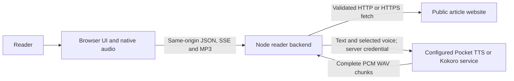
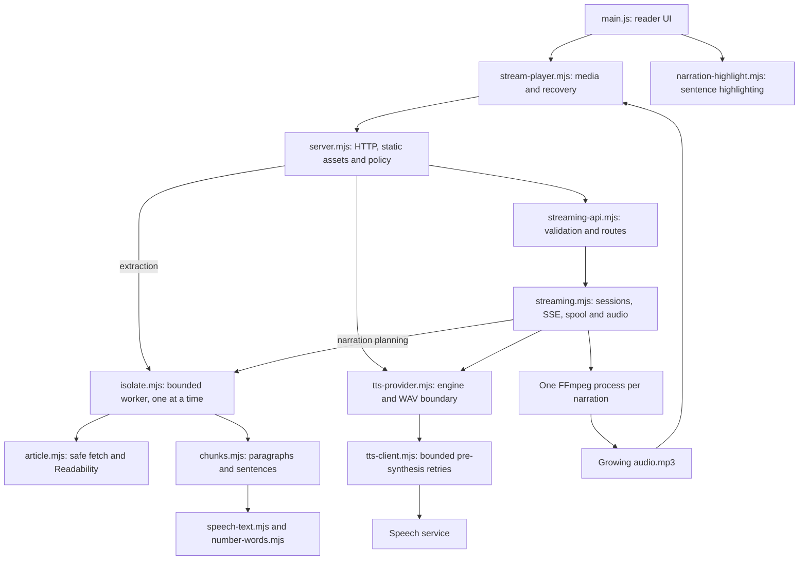
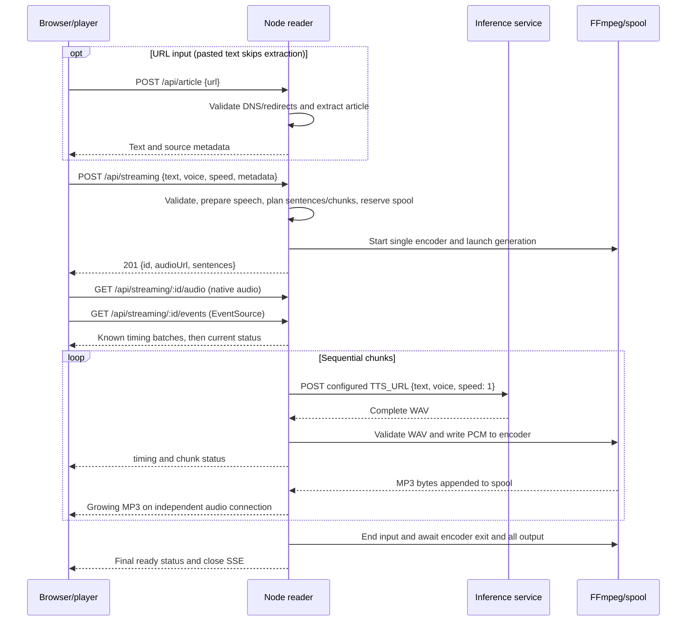
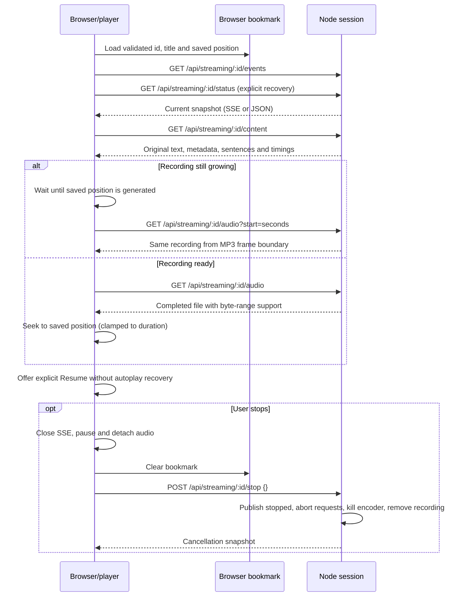
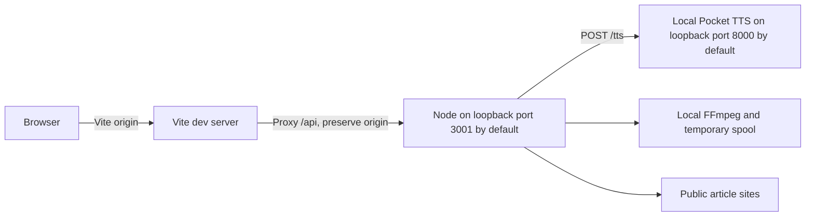
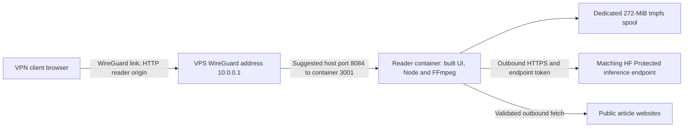

# Architecture

A short architectural description of the current implementation, not a claim that its deployment template is live. Start with the [product README](../README.md), [visual explanation](how-it-works.html), [development guide](development.md), or [evidence and experiments](experiments.md).

## 1. Introduction and goals

Article Reader turns extracted web articles or pasted text into English or French narration. Listening should begin before the entire article is generated, remain under native browser media control, and recover an existing recording after a reload without synthesizing it again. The displayed article stays unchanged while speech preparation improves pronunciation and sentence highlighting follows playback.

The primary user is a reader on desktop or mobile; operators need bounded resource use, private inference credentials and explicit deployment/rollback procedures. Mobile playback and inference performance are evidence-dependent, not universal guarantees.

## 2. Constraints

- Browser JavaScript uses same-origin APIs; Node owns extraction, synthesis orchestration and FFmpeg encoding. No browser model download is needed.
- A configured provider supplies complete mono 24-kHz PCM16 WAV chunks at synthesis speed 1. Node applies playback speed 0.5–2 with FFmpeg `atempo`.
- Pocket TTS is the default; Kokoro is opt-in. Engine, voice catalog and endpoint must match; there is no automatic detection or failover.
- Sessions belong to one reader process. There is no durable database, distributed session routing, cross-tab coordination or offline narration.
- Only one narration may generate per reader instance, with no admission waiting queue. Inference capacity is a separate constraint.
- The reader answers only to IP literals, `localhost`, and names listed in `ALLOWED_HOSTS`; every page carries a strict Content-Security-Policy; internal errors are logged with details and returned generically.

## 3. Context and scope

Public article sites are untrusted input. Inference is a separately operated service, local during development or remote in the deployment template; remote inference receives narration text. VPN access is the proposed production access boundary, not an application user-account system. Source URL metadata retained with pasted/extracted content is not itself fetched by narration admission.

## 4. Solution strategy

Extract once, prepare speech without changing displayed text, then synthesize small sequential chunks into one continuous MP3. A small first chunk favors early audio; subsequent chunks amortize request overhead. Native `<audio>` owns decoding, buffering and playback, while SSE supplies progress and timing rather than scheduling audio. A bounded spool enables streaming now and recovery later. Explicit Stop cancels server-owned work; reload preserves an acknowledged recording.

## 5. Building block view

`server.mjs` exposes `/api/config`, `/api/article`, `/api/health`, the compatibility `/api/tts` WAV route and streaming routes. `/api/health` checks the reader, not inference. Compatibility WAV accepts 1–1,000 characters containing a letter/number, a supported voice and speed 1; the reader's normal narration uses `/api/streaming`.

`streaming-api.mjs` validates admission and bounded metadata (title 200, byline 500, source URL 2,048 characters). `streaming.mjs` owns the session map, admission exclusion, encoder lifetime, temporary files, subscribers, generation/retention timers and audio consumers. `tts-provider.mjs` keeps credentials server-side, rejects redirects and non-WAV responses, bounds each returned WAV at 12,000,000 bytes, and supplies the configured voice catalog.

`errors.mjs` marks user-facing messages with an HTTP status; anything unmarked is internal, returned as a generic message and logged with details. `csp.mjs` supplies one Content-Security-Policy shared by `server.mjs` and the Vite dev server, so development runs under the production policy. `isolate.mjs` runs extraction and narration planning in fresh worker threads with heap and time budgets, so hostile input can exhaust only its own worker, never the server's event loop.

## 6. Runtime view

### Admission and narration

Generation begins before the admission response and continues independently of status delivery. Chunk progress/timings mean PCM has entered the encoder, not necessarily that every corresponding MP3 byte has already emerged. The final ready snapshot follows complete encoder output. Extraction and narration planning never run on the event loop: each runs once in a bounded worker (see building blocks), so pathological input fails with a user-facing error instead of blocking requests.

### SSE and timing contract

`GET /api/streaming/:id/events` uses named `timing` and `status` events. Each connect/reconnect first sends all known timings in batches (up to 1,000 entries), catching up before subscribing to live events, then immediately sends the current status. No event replay log or recurring `/status` polling is needed.

- `status` contains `id`, `state` (`generating`, `ready`, `error`, `stopped`), `warming`, `generated`, `total`, `bytes`, `audioSecondsGenerated`, `firstByteSeconds`, `elapsedSeconds`, `timed`, `consumers`, optional `error`/`mark`, `voice`, `speed`, `title`, `generationDeadline`, `expiresAt` and `generatedAfterMark`.
- First audio bytes, chunk progress, warmup changes, audio-consumer/mark changes and terminal states publish immediately, flushing pending counters. Byte-only encoder updates use the latest counters at most once per 250 ms; ready includes the final byte count.
- Comment heartbeats run every 15 seconds. At most four status connections, including timing replays, are admitted per recording. Slow live subscribers are disconnected rather than accumulating unlimited output; timing replay drain waits are bounded at 15 seconds. Ready/error/Stop closes SSE. Status disconnects do not cancel narration or count as audio consumers.
- `timing` is `{from, timings}`: `from` is the first sentence index, and each timing is `[start, end]` in recording seconds. Admission and `GET /content` supply sentence `[start, end]` offsets into the original narrated text; `/content` also supplies timings for recovery.
- Chunk audio duration comes from PCM sample count adjusted for selected speed. Sentence boundaries within it are estimates, weighted by prepared spoken length plus 12 characters of pause allowance per sentence and rounded to milliseconds. This is not forced alignment.

The UI displays exactly the narrated text, including pasted input. Highlighting maps recording time back to original sentence ranges; auto-follow scrolls only the article panel and pauses for five seconds after manual scrolling. Browsers without CSS Custom Highlight support still play audio.

### Reload, recovery and Stop

`GET /status` remains for explicit recovery/retry, permanent SSE rejection, media-error diagnosis and completion checks. Revision tracking prevents an older JSON response overwriting a newer SSE state. A recoverable connection failure retains the bookmark; expiry/server restart requires an explicitly new narration. `/content` returns 410 when content has been discarded. `/mark` records diagnostics (playback position and then-current counters), not a persistent browser bookmark.

Pause stops listening, not generation. Native media/network behavior can leave or close an audio connection; generation is bounded either way. Stop during admission waits for the acknowledged ID before sending cancellation, avoiding an orphan session. Disposal/reload leaves acknowledged recordings recoverable; an unacknowledged admission is cancelled once its ID arrives. Stop cannot interrupt speech computation already running inside the inference service.

## 7. Deployment view

### Development infrastructure

Vite's API target follows `READER_BACKEND_PORT`; the backend listener is configured separately. Production-built assets are not required by the development UI. Local Python services own model loading; optional Kokoro must be explicitly paired with its engine setting. See [development servers and configuration](development.md).

### Production deployment template, not verified live state

`Dockerfile` builds Vite assets and installs only production Node dependencies plus FFmpeg in the runtime image; Python and model weights are separate. `compose.yaml` specifies non-root execution, read-only root filesystem, dropped capabilities, no-new-privileges, bounded logs, 512 MiB memory, one CPU and 128 PIDs. These are initial template limits, not load-test results. The container binds all its interfaces internally; the host publication binds only the WireGuard destination address, which is not itself an ingress firewall rule.

The suggested port is not verified free. VPS firewall/NAT, browser playback, HF access, image publication and rollout require the [deployment runbook](deployment.md); adding template files does not perform them. That runbook records an older production reader/Kokoro pairing, not a verified deployment of the current Pocket-default reader. Roll out and roll back reader image, engine, endpoint and credential as a pair. [HF inference](hf-inference.md) covers endpoint setup and actual evidence.

The spool must cover retained-session count × per-recording byte limit plus headroom; increasing application limits does not resize tmpfs or memory. A future proxy must preserve unbuffered long-lived SSE and audio responses; SSE idle timeout must exceed its heartbeat with headroom. HTTPS/proxy setup is deferred in the existing template, not silently assumed here.

## 8. Cross-cutting concepts

### Speech preparation and source mappings

`speech-text.mjs` makes deterministic speech-only rewrites in the voice language (English/French). This addresses observed digit-by-digit and abbreviation misreadings such as `42`, `128K` and `3.5`, not arbitrary linguistic interpretation. Rewrites claim nonoverlapping ranges; every generated character maps to the original expression, unchanged characters map one-to-one, and skipped URLs do not shift later highlights. `chunks.mjs` segments prepared speech with language-specific `Intl.Segmenter`, preserves paragraphs, joins title/initial fragments and packs whole sentences into a 220-character first chunk and 500-character later chunks. Oversized sentences split at words, or hard boundaries when necessary, becoming separate highlight units.

Numbers come out as words: integers, decimals, grouped amounts and their suffixes (`128K`, `16GB`, `%`, `fps`), English ordinals (`22nd`) and years inside a year context (`in 1999`, `the 1990s`). Currency symbols before/after a recognized amount expand too (`$50`, `50 €`, `$1.5B`), as do multiplier ranges (`2-3x` → “two to three times” / “deux à trois fois”) and numbered units with singular/plural agreement.

Clock times, dates and phone numbers follow the language: `9:05 PM` and French `10h30`, ISO dates, day-first dates and slash/dot dates whose ordering is unambiguous — an English `09/10/2026` is left alone — and abbreviated months in date context (`Sep 30`, `30 sept. 2026`). English phone numbers are spoken digit by digit, French domestic numbers in pairs. The abbreviation list is deliberately small: English `Dr.`, `Mr.`, `Mrs.`, `Prof.`, `No.`, `#number`, `e.g.`, `i.e.`, `vs.`, `approx.`, `etc.`; French `M.`, `MM.`, `Mme`, `Mlle`, `Dr`, `Pr`, `n°`/`N°`, `p. ex.`, `c.-à-d.`, `env.`, `vs.`, `etc.` Titles require a following name, number abbreviations require a number — these are rules, not global string replacements. Capital-letter codes become spelled forms (`H100` → “H one hundred”, `Q3`), `TL;DR` becomes spaced letters because its semicolon disrupted narration, and French ordinals expand (`10e`/`10ème`/`10ᵉ`, `1er`/`1re`).

URLs are never narrated in full: Markdown links keep their label, an inline URL is spoken as its domain (“github dot com”), and a URL alone on its line or cited in brackets after a phrase is skipped. Nothing is fetched during preparation; link-only text is rejected.

Recognized units are case-sensitive — `ms`, `µs`/`μs`, `ns`, `s`, `min`, `h`; `mm`, `cm`, `m`, `km`, `m²`, `km²`, `m/s`, `km/h`, `mph`; `mg`, `g`, `kg`, `ml`/`mL`, `L`; `Hz`, `kHz`, `MHz`, `GHz`; `W`, `kW`, `MW`, `Wh`, `kWh`; `°C`, `°F`, `°` — and the single-letter `s`, `h`, `m`, `g` require surrounding spacing to avoid other meanings.

Everything not covered stays as written: identifiers and codes like `d1-3B`, `Phi-3`, `COVID-19`, `0x1e`, `4x4`, versions (`3.11.2`), IPs (`192.168.1.1`) and times with seconds (`10:30:15`); no general date-format or unit expansion is promised. Product numbers are read as cardinals (`RTX 4090` → “four thousand ninety”), French numbers generally default to the masculine (`21 voitures` → “vingt et un”) with selected feminine unit handling, a bare French `1` stays as written, and without a year context “from 2020 to 2024” uses cardinals. Whether a bracketed URL is a skippable citation is a heuristic: it must follow at least two words of its clause. See [pronunciation regression procedure](development.md#manual-pronunciation-regression-check) and [experiments](experiments.md).

### Lifetime, resource limits and privacy

Default configurable narration limits are 100,000 text characters, 64,000,000 audio bytes per recording, 20 minutes generation, six hours retention after ready/error, two minutes without audio consumers while generating, at most four concurrent audio connections per recording (`STREAM_MAX_CONSUMERS`), and four session slots. Only one slot can generate. Narration planning runs in a bounded worker whose heap scales with the text limit (about 290 MB at 1,000,000 characters) under a 20-second deadline. At capacity, admission evicts the oldest terminal session with no audio consumers or rejects with 429 if none qualifies. Optional pacing is an integer 0–8 seconds between chunks; it does not remove generation deadlines. See [backend configuration](development.md#backend-configuration) for environment names and bounds.

Text/metadata live temporarily in the process; MP3 lives in a private instance-owned spool (directory mode 0700, file mode 0600). Session/spool ownership locks prevent two processes sharing the same spool. Startup cleans abandoned/default instance spools and old session directories in its owned spool; restart never restores sessions. Ready keeps bounded recovery content; error/Stop discards text and audio. Error snapshots remain temporarily for diagnosis. Stop removes the recording; retention expiry also removes the session; shutdown stops all sessions.

Browser storage holds only a validated recording reference, title and best-known playback position, not article text or audio. Completion/Stop clears its bookmark. Credentials never enter browser configuration. Remote inference receives text; operators with Docker access can inspect container credentials. Same-origin checks reject cross-origin/cross-site streaming reads and writes, and POSTs require JSON; these are not per-user authorization or abuse controls.

Requests whose `Host` header is neither an IP literal, `localhost` nor a name listed in `ALLOWED_HOSTS` are rejected with 403, so a page that rebinds its own DNS name to this server cannot drive the API from a victim's browser. Every page response carries a strict Content-Security-Policy — same-origin scripts, styles, media, connect and images only; no framing, forms, plugins or base-URI override — in development and production alike. Internal errors are logged with details and returned to clients as generic messages; only errors explicitly marked with an HTTP status are shown.

### Safe article extraction and inference errors

Article fetch accepts public HTTP/HTTPS URLs on standard ports 80/443 without credentials. Every DNS result must be public unicast: private, loopback, link-local and reserved addresses are rejected, including IPv4-compatible IPv6 such as `::7f00:1` whose tail hides an IPv4 address. The selected checked IP is pinned to the connection, and redirects are revalidated. Limits are a 15-second overall fetch deadline, five redirects and 3,000,000 HTML bytes. Only HTML/XHTML with identity encoding is accepted; UTF-8 is assumed.

Parsing and extraction never run on the event loop. Each page is read in one fresh worker thread (256 MiB heap, 10-second deadline), and only one extraction runs at a time: concurrent requests get 429/Retry-After. Readability parses at most 50,000 elements, and nesting beyond 400 levels is rejected because Readability's cost grows roughly cubically with nesting depth. Extracted text must be 80–100,000 characters. A hostile page fails its own extraction with a user-facing error (422) instead of exhausting the container. This cannot unlock paywalls or reliably extract JS-rendered pages or remove every consent/ad fragment; paste is the fallback.

The provider exposes bounded errors without leaking endpoint credentials/transport details. Narration retries only explicit pre-synthesis 503 `INFERENCE_UNAVAILABLE` and 429 `INFERENCE_BUSY` responses, respecting `Retry-After`; transport failures that may have synthesized are not retried. Per-chunk waits have a shared 180-second deadline, with at most 20 startup attempts; busy retries share the deadline. Warmup is distinct from busy waiting. These limits also sit inside the narration's overall generation deadline.

## 9. Architecture decisions

| Decision | Reason and consequence |
| --- | --- |
| Native audio plus continuous MP3 | Browser media owns playback and lock-screen integration; one encoder avoids independent WAV scheduling/joins. Mobile evidence remains bounded. |
| Server-owned sequential generation | Listening/reload need not drive synthesis; one active generation limits reader-side contention, but does not size the speech service. |
| SSE plus explicit JSON recovery | Progress is pushed independently of audio; reconnect uses current timings/state, not an event log or recurring poll. |
| Separate speech and displayed text | Deterministic pronunciation improvements preserve original-source highlighting; mapping and timing estimates must remain coordinated. |
| Temporary instance-local recordings | Simple bounded recovery without durable persistence; restart/rollout loses recordings and horizontal sharing is absent. |
| Explicit engine pairing | Small supported catalogs and a strict WAV boundary; incompatible reader/endpoint combinations fail rather than auto-switch. |
| Bounded isolation workers | Extraction and narration planning face hostile input; a fresh worker with heap/time budgets fails the request instead of the process or event loop. |
| Host allowlist and strict CSP | A DNS rebind cannot match the allowlist, and pages admit only same-origin resources; both policies apply identically in development and production. |
| Explicit user vs. internal errors | Only messages marked with an HTTP status reach clients; internal details stay in logs. |

Historical alternatives, measurements and their caveats belong in [experiments](experiments.md), [streaming spike](streaming-spike.md) and [HF inference](hf-inference.md), not duplicated benchmark tables here. The old `main_.js` browser-inference experiment was deleted as dead code; its last version remains in git history and its removed `kokoro-js` dependency would need separate installation to revisit it.

## 10. Quality requirements

- **Responsiveness:** audio can start after the first encoded output, without waiting for full narration; the 220-character first chunk is a mechanism, not a latency guarantee.
- **Correctness/recovery:** display original source ranges, count audio at selected tempo, recover the same recording and never automatically re-synthesize an expired bookmark.
- **Bounded operation:** enforce admission, text/audio/time/retention limits and bounded status subscribers; a slow observer must not block synthesis or audio.
- **Privacy/security:** credentials remain server-side; article fetching validates and pins public destinations; browser persistence avoids full content/audio.
- **Compatibility:** play without sentence highlighting when unsupported; use Media Session play/pause where implemented, and require explicit gesture when autoplay is denied.

Existing automated and manual checks are cataloged in [development](development.md#tests); actual observed browser/inference results and limitations are in [experiments](experiments.md). This document's diagrams describe source behavior, not a new test result.

## 11. Risks and technical debt

- Sentence timing is estimated inside a chunk. One Pocket TTS sample showed about 0.2 seconds average and 0.6 seconds worst-case boundary error; this is sample evidence, not a guarantee ([experiments](experiments.md)).
- Growing MP3s do not provide arbitrary seeking; a recovered growing stream cannot seek before its restored start. Completed recordings support byte ranges. Offline narration and guaranteed unkillable mobile playback are not implemented. Use one playback tab.
- Inference compute/queue capacity limits concurrent listening. Models are shared per inference worker, not loaded for each user; the reader's single-generation limit does not bound compatibility WAV traffic or provide per-user rate limits/cost control.
- Extended local Kokoro CPU testing previously showed memory growth and OOM at a 6-GiB container limit, not an observed HF endpoint failure. Restart restored service but did not fix the cause. Pocket passed a bounded 30-request mixed-language run without OOM; longer production testing is still needed. See [known inference follow-up](streaming-spike.md) and [HF evidence](hf-inference.md).
- Server restarts and image replacements invalidate recovery. Spool/memory provisioning must track configured limits; storage can fail before the nominal recording byte limit if tmpfs is undersized.
- Extraction and narrow speech heuristics cannot understand every website or expression; ambiguous dates, grammatical gender and citations have deliberate limits described above.
- Production rollout, network/firewall access, endpoint pairing, hosted sizing and physical playback must be verified through the runbooks. Docker health alone neither proves inference works nor restarts an unhealthy but running process.

## 12. Glossary

| Term | Meaning here |
| --- | --- |
| Admission | Validated creation of a narration session, acknowledged by its ID. |
| Chunk | A bounded prepared-text synthesis request, usually containing whole sentences. |
| Sentence | An original-text highlight range, sometimes a piece of an oversized sentence. |
| Recording/session | Instance-local content, generated MP3, counters and recovery state identified by UUID. |
| Spool | Private temporary storage holding growing/completed MP3 files. |
| SSE | Server-sent events carrying status/timing, separate from audio transport. |
| Warmup | Inference unavailable/starting; different from an already-started busy service. |
| Bookmark | Browser-held session reference, title and best-known recording position. |
| PCM / atempo | Uncompressed audio samples / FFmpeg's tempo adjustment filter. |
| Protected endpoint | HF TLS endpoint authenticated by token; not PrivateLink-only “Private” networking. |
